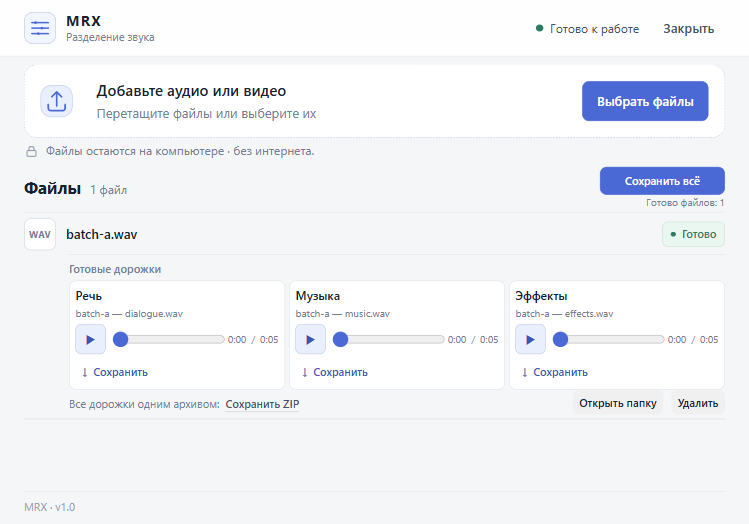

# MRX

Офлайн‑приложение для Windows x64, которое разделяет звук из аудио и видео на три дорожки: речь, музыку и эффекты. Это portable‑сборка: MRX запускается отдельным окном и обрабатывает файлы локально на CPU.

[Скачать MRX.zip (v1.0.0)](https://github.com/jimmorisedu-boop/MRX/releases/latest/download/MRX.zip) · [Открыть страницу Releases](https://github.com/jimmorisedu-boop/MRX/releases)

Для скачивания нужен доступ к приватному репозиторию.



_Окно MRX после обработки тестового аудиофайла._

## Что делает MRX

MRX принимает один или несколько аудио/видео файлов, обрабатывает очередь последовательно и сохраняет отдельные WAV‑дорожки.

| Дорожка | Содержимое |
| --- | --- |
| **Речь** | голос и диалог |
| **Музыка** | музыкальная составляющая |
| **Эффекты** | окружающие и прочие звуки |

В окне доступны:

- добавление нескольких файлов перетаскиванием или через выбор файлов;
- очередь с селектором файла, когда задач несколько;
- прослушивание каждой из трёх дорожек;
- скачивание одной дорожки или ZIP для одной задачи;
- «Сохранить всё» — один ZIP с отдельной папкой для каждого готового файла;
- открытие папки результатов и удаление готовых результатов из интерфейса.

## Установка

1. Скачайте `MRX.zip` из [страницы Releases](https://github.com/jimmorisedu-boop/MRX/releases). Нужен архив релиза, а не `Code → Download ZIP`: последний содержит исходники и не является готовой portable‑сборкой.
2. Полностью распакуйте архив в папку, доступную для записи. Не переносите `MRX.exe` отдельно от остальных файлов архива.
3. Запустите `MRX.exe`.

Отдельно устанавливать Node.js, Python или модель не нужно: модель MRX, FFmpeg и файлы Microsoft Visual C++ x64 уже входят в папку приложения. Видеокарта не требуется; для обработки интернет не нужен.

## Работа и результаты

Перетащите файлы в окно или нажмите «Выбрать файлы». MRX добавит их в очередь и обработает последовательно на CPU. После завершения можно прослушать дорожки, сохранить отдельную дорожку, скачать ZIP задачи или нажать «Сохранить всё».

Готовые WAV находятся рядом с `MRX.exe`:

```text
data\outputs\<идентификатор-задачи>\
```

В папке задачи лежат три WAV. ZIP конкретной задачи собирается при скачивании; общий архив «Сохранить всё» временно кэшируется, при этом хранится только его последняя версия. Временные загрузки очищаются после обработки, а кэш архивов — при закрытии или следующем запуске. Исходные файлы остаются на месте и не изменяются и не удаляются MRX.

## Ограничения

- Обработка выполняется на CPU; наличие GPU не требуется.
- Текущий предел — до 20 файлов за одно добавление.
- Декодированный звук ограничен 1,5 GB PCM. При текущем стерео‑декодировании 44,1 kHz это около 70 минут звука; слишком длинный файл отклоняется до основного декодирования, если контейнер сообщает длительность.
- Длинные файлы могут потребовать больше оперативной памяти и места на диске.
- Разделение зависит от исходной записи; MRX не обещает идеальный результат для каждого файла.

## Лицензии и исходники компонентов

Готовый архив содержит каталог `LICENSES/` с текстами лицензий, атрибуцией и provenance компонентов. В состав входят MRX ONNX и модель MERL (MIT), пакеты `@audio/neural-separate` и `@audio/neural-runtime` (MIT), ONNX Runtime (MIT), FFmpeg (LGPL‑3.0-or-later), Electron/Chromium и Node.js. Полные версии, закреплённые ревизии и сведения о сборке перечислены в [инженерной документации](docs/BUILD.md#лицензии-и-provenance). Отдельная лицензия самого проекта в репозитории не заявлена.

## Для разработчиков

Команды сборки portable‑папки, проверки сервера, тесты, подпись `MRX.exe`, зависимости и provenance вынесены в [docs/BUILD.md](docs/BUILD.md).
